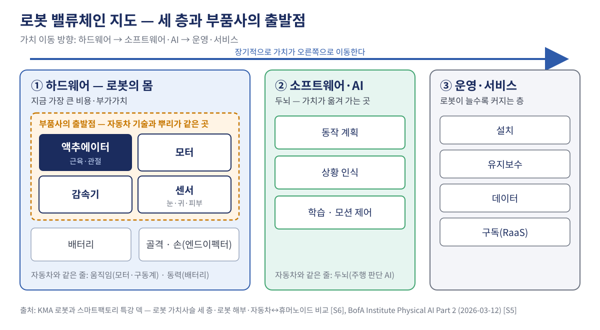

# 1장. 로봇을 해부하면 밸류체인이 보인다

> **이 장의 핵심 질문** — 로봇은 어떤 부품으로 이뤄지고, 가치사슬은 몇 층으로 나뉘는가?

---

## ① 용어와 '왜'

| 용어 | 뜻 |
|---|---|
| **센서** | 로봇의 눈·귀·피부. 카메라·라이다·힘 감지로 상황을 파악한다 |
| **제어기·AI** | 로봇의 두뇌. 인식 → 판단 → 동작 계획을 맡는다 |
| **액추에이터** | 로봇의 근육·관절. 전기 신호를 움직임으로 바꾸며 힘과 속도를 결정한다 |
| **엔드이펙터** | 로봇의 손. 그리퍼·흡착 같은 작업 도구로 일의 종류를 결정한다 |
| **자유도(DoF)** | 로봇이 움직일 수 있는 관절 방향의 수. 많을수록 유연하지만 만들기 어렵다 |
| **가치사슬(밸류체인)** | 부품 → 완성품 → 운영까지 가치가 더해지는 단계의 연결 |
| **로봇 밀도** | 제조업 종업원 1만 명당 가동 중인 산업용 로봇 수 |

**왜 해부부터 하는가** — 부품사가 로봇 시장을 볼 때 "로봇 시장이 크다"는 말만으로는 할 일이 정해지지 않는다. 로봇을 부품으로 쪼개야 **우리 제품이 들어갈 자리**가 보이고, 가치사슬을 층으로 나눠야 **그 자리의 돈이 커지는지 줄어드는지**가 보인다. 원본 강의도 "이 해부학이 가치사슬과 원가 이야기의 바탕"이라고 정리한다 [S6].

## ② 본문

### 로봇은 네 부분으로 읽는다

어떤 로봇이든 네 부분의 조합이다 [S6].

| 부분 | 사람으로 치면 | 현장에서 확인할 사양 |
|---|---|---|
| 센서 | 눈·귀·피부 | 인식 거리, 조명·먼지 조건 |
| 제어기·AI | 두뇌 | 가르치는 방식(티치 펜던트·시연) |
| 액추에이터 | 근육·관절 | 페이로드(들 수 있는 최대 무게), 반복 정밀도 |
| 엔드이펙터 | 손 | 교체 시간, 잡을 수 있는 부품 |

BofA 연구소는 같은 구조를 마음(AI)·몸(센서·액추에이터·손·에너지·구조재)·혼(균형과 동작을 조율하는 모션 제어)으로 나눈다 [S5]. 이름은 달라도 "판단하는 부분"과 "움직이는 부분"을 나눠 본다는 점은 같다.

### 로봇의 종류 — 휴머노이드는 막내다

| 종류 | 특징 | 주 일터 |
|---|---|---|
| 다관절 산업로봇 | 사람 팔 모양, 크고 빠르고 강함 | 차체 용접 · 도장 · 프레스 핸들링 |
| 협동로봇(코봇) | 작고 느리지만 사람 옆에서 안전 | 조립 보조 · 검사 · 나사 체결 |
| AMR · AGV | 바퀴 달린 운반 로봇 | 부품 물류 · 공정 간 이동 |
| 4족 보행 | 계단·험지 이동 | 순찰 · 점검 · 데이터 수집 |
| 휴머노이드 | 사람 형상 — 사람 환경을 그대로 쓴다 | 부품 정렬부터 시작 |

출처: [S6]

공장·창고·계단이 모두 사람 기준으로 설계돼 있어서, 휴머노이드는 환경을 바꾸지 않고 들어갈 수 있다 [S6].

### 숫자로 보는 산업용 로봇 시장

| 지표 | 값 | 기준 |
|---|---|---|
| 세계 신규 설치 | 542,000대 | 2024년 [S1] |
| 세계 가동 대수 | 4,664,000대 (+9%) | 2024년 [S1] |
| 중국의 세계 신규 설치 비중 | 54% | 2024년 [S1] |
| 한국 신규 설치 | 30,600대 (-3%) | 2024년 [S1] |
| 한국 로봇 밀도 | 종업원 1만 명당 1,012대 | 2022년 데이터 [S3] |

- 2024년 세계에서 산업용 로봇 542,000대가 새로 설치됐고, 가동 대수는 4,664,000대로 전년보다 9% 늘었다 [S1].
- 한국의 로봇 밀도는 제조업 종업원 1만 명당 1,012대로 세계 1위다(2022년 데이터) [S3].
- 한국은 로봇을 **쓰는** 나라로는 이미 앞서 있다. 이 교재의 질문은 로봇을 **만드는** 가치사슬에서 우리가 어디에 서는가다.

### 로봇 가치사슬은 세 층이다

*그림 1-1. 로봇 밸류체인 지도 — 세 층과 부품사의 출발점. 구성: 원본 강의 '로봇 가치사슬은 세 층이다' [S6], 로봇 해부 [S6], BofA 마음·몸·혼 구조 [S5]를 바탕으로 작성.*

| 층 | 무엇 | 지금의 위치 |
|---|---|---|
| ① 하드웨어 — 몸 | 액추에이터 · 모터 · 감속기 · 센서 · 배터리 · 골격 | 지금 가장 큰 비용·부가가치 |
| ② 소프트웨어·AI — 두뇌 | 동작 계획 · 상황 인식 · 학습 | 장기적으로 가치가 이쪽으로 이동 |
| ③ 운영·서비스 | 설치 · 유지보수 · 데이터 · 구독(RaaS) | 로봇이 늘수록 커지는 층 |

출처: [S6]

가치는 **하드웨어 → 소프트웨어·AI → 운영·서비스** 방향으로 이동한다 [S6]. 지금 돈은 하드웨어, 그중에서도 액추에이터에 몰려 있다 — 얼마나 몰려 있는지는 2장에서 숫자로 본다.

## ③ 케이스 — 자동차와 로봇은 쌍둥이다

원본 강의는 자동차와 휴머노이드를 나란히 놓고 "이 강의 전체를 관통하는 핵심 통찰"이라고 부른다 [S6].

| 구성 | 자동차 | 휴머노이드 |
|---|---|---|
| 보는 눈 | 카메라 · 레이더 · 라이다 | 카메라 · 각종 센서 |
| 움직임 | 모터 · 구동계 · 제어 | 액추에이터 · 관절 · 제어 |
| 동력 | 배터리 · 전력관리 | 배터리 · 전력관리 |
| 두뇌 | 주행 판단 AI | 동작 판단 AI |
| 만드는 법 | 대량 조립 · 품질관리 | 대량 조립 · 품질관리 |

전기차는 이미 "바퀴 달린 컴퓨터 + 배터리 + 모터"다. 바퀴를 다리로, 차체를 팔로 바꾸면 휴머노이드에 가까워진다. 그래서 원본 강의는 현대차가 새 산업에 '진입'하는 것이 아니라 **이미 가진 능력을 옮기는 것**이라고 결론짓는다 [S6].

부품사에게 이 표가 주는 메시지는 두 가지다. 첫째, "움직임" 줄 — 액추에이터는 자동차 모터·구동 기술과 뿌리가 같다 [S6]. 둘째, "만드는 법" 줄 — 원본 강의는 현대차의 강점을 로봇 기술 자체보다 "대량으로 안정적으로 만드는 제조 능력"으로 본다 [S6]. 이 능력이 협력사 공급망에도 통하는지는 회사마다 따져 봐야 한다. 3장에서 이 두 줄이 실제 진입으로 이어진 사례를 본다.

## ④ 요약

1. 로봇은 **센서 · 제어기·AI · 액추에이터 · 엔드이펙터** 네 부분으로 읽는다.
2. 가치사슬은 **하드웨어 → 소프트웨어·AI → 운영·서비스** 세 층이고, 지금 돈은 하드웨어에 있다.
3. 자동차와 휴머노이드는 부품·제조 방식이 거의 같아, 부품사의 출발점은 **이미 가진 능력**이다.

## ⑤ 생각해 볼 질문

1. 우리 회사의 주력 제품은 로봇의 네 부분 중 어디에 가장 가까운가? 이유를 한 줄로 적어 보자.
2. 가치사슬 세 층 중 우리 회사가 지금 닿을 수 있는 층과, 앞으로 닿고 싶은 층은 어디인가?
3. 케이스의 비교표에서 우리 회사 역량이 가장 강한 줄은 무엇이고, 가장 약한 줄은 무엇인가?

---

### 이 장의 출처

- [S1] IFR, *World Robotics 2025 report – Industrial Robots*, 2025-09-25. https://ifr.org/ifr-press-releases/news/global-robot-demand-in-factories-doubles-over-10-years
- [S3] IFR, *Global Robotics Race: Korea, Singapore and Germany in the Lead*, 2024-01-10. https://ifr.org/ifr-press-releases/news/global-robotics-race-korea-singapore-and-germany-in-the-lead
- [S5] Bank of America Institute, *Physical AI Part 2*, 2026-03-12. https://institute.bankofamerica.com/content/dam/transformation/physical-ai-part-2.pdf
- [S6] KMA 자동차특화 AI 융합 전문가 과정, *로봇과 스마트팩토리 특강* 인트로·본 강의 덱. https://github.com/keerhee/kma-auto-genai-3-1/tree/main/Robot_Special

전체 출처와 숫자 검증 기록: `forge/sources.md`, `forge/facts.csv`
