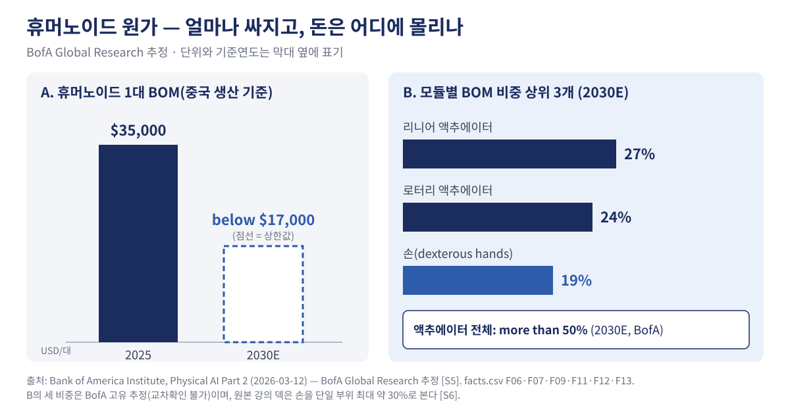

# 2장. 돈은 어디에 있나 — 휴머노이드 원가 구조

> **이 장의 핵심 질문** — 휴머노이드 한 대의 원가는 어느 부품에 몰려 있고, 왜 그런가?

---

## ① 용어와 '왜'

| 용어 | 뜻 |
|---|---|
| **BOM(Bill of Materials)** | 제품 한 대를 만드는 데 드는 부품·재료 목록과 그 원가. 이 장에서는 휴머노이드의 하드웨어 원가를 뜻한다 |
| **액추에이터** | 로봇의 근육. 모터·드라이브·변속기(감속기)·센서를 작은 모듈로 묶은 구동 장치다 [S5] |
| **리니어 / 로터리 액추에이터** | 늘었다 줄었다 하는 직선 운동 관절 / 도는 회전 운동 관절 [S5] |
| **감속기** | 모터의 빠른 회전을 느리고 힘 있게 바꾸는 장치. 액추에이터 안에 들어간다 |
| **손(dexterous hands)** | 다섯 손가락처럼 정교하게 잡는 엔드이펙터 |
| **2030E** | E는 추정(Estimate). 실제 값이 아니라 기관의 전망이다 |

**왜 원가 구조를 보는가** — 부품사에게 원가표는 곧 **매출표**다. 완성 로봇 회사가 원가의 절반을 쓰는 곳이 있다면, 그 절반은 누군가의 매출이 된다. 원가가 어디에 몰리는지 알아야 어떤 부품을 겨냥할지 정할 수 있고, 원가가 얼마나 빨리 내려가는지 알아야 그 부품으로 돈을 벌 수 있는지 판단할 수 있다.

## ② 본문

### 휴머노이드는 빠르게 싸지고 있다

| 구분 | 1대당 BOM | 기준 |
|---|---|---|
| 파일럿 단계 개발 | $90,000 to 100,000 | 2026년 발행 시점, BofA 추정 [S5] |
| 중국 생산 휴머노이드 | $35,000 | 2025년 [S5] |
| 중국 생산 휴머노이드 전망 | below $17,000 | 2030E [S5] |

- BofA는 중국에서 만든 휴머노이드의 BOM을 2025년 $35,000로 추정하고, 2030년에는 $17,000 미만으로 대략 절반이 될 것으로 본다 [S5].
- BofA는 그 이유로 규모의 효과와 부품 설계 개선을 든다 [S5].

### 원가의 가장 큰 몫은 액추에이터다

같은 질문에 여러 출처가 같은 방향의 답을 낸다.

| 출처 | 액추에이터의 원가 비중 | 기준 |
|---|---|---|
| BofA Global Research | more than 50% | 2030E [S5] |
| 원본 강의 덱 | 40~60% | 덱 기준(연도 미표기) [S6] |
| Meticulous Research | 40–60% | 시장조사 요약 [S10] |

- BofA는 액추에이터가 전체 BOM의 50% 이상을 차지할 것으로 본다(2030E) [S5].
- 원본 강의는 구동부(액추에이터)를 원가의 40~60%로 본다 [S6].

**왜 절반이나 되는가** — 휴머노이드 한 대에는 관절이 수십 개 있고, 관절마다 액추에이터가 들어간다 [S6]. BofA도 휴머노이드가 보통 수십 개의 액추에이터를 쓴다고 설명한다 [S5]. 부품 하나하나는 작아도, 개수가 곱해지면서 원가의 중심이 된다.

### 2030년 원가 구성 — 무엇이 가장 비싼가

*그림 2-1. A: 휴머노이드 1대 BOM(중국 생산 기준) 2025년 $35,000 → 2030E $17,000 미만. B: 모듈별 BOM 비중 상위 3개(2030E). 출처: Bank of America Institute, Physical AI Part 2 (2026-03-12), BofA Global Research 추정 [S5]. B의 세 비중은 BofA 고유 추정이다.*

| 모듈 | BOM 비중 | 기준 |
|---|---|---|
| 리니어 액추에이터 | 27% | 2030E, BofA 추정 [S5] |
| 로터리 액추에이터 | 24% | 2030E, BofA 추정 [S5] |
| 손(dexterous hands) | 19% | 2030E, BofA 추정 [S5] |

- BofA는 2030년 BOM에서 리니어 액추에이터가 27%로 가장 크고, 로터리 액추에이터 24%, 손 19% 순일 것으로 본다 [S5].
- 이 세 비중은 BofA 한 기관의 추정이라 다른 출처로 교차 확인할 수 없다. 인용할 때는 반드시 "BofA 추정"을 붙인다.

### 얼마나 많이 팔릴까

| 구분 | 연간 출하 | 기준 |
|---|---|---|
| 추정 | 20,000대 | 2025E [S5] |
| 전망 | 1.2 million대 | 2030E [S5] |
| 전망 | 10 million대 | 2035E [S5] |

- BofA는 휴머노이드 연간 출하가 2025년 20,000대(2025E)에서 2035년 10 million대로 늘어날 것으로 본다 [S5].
- 원가가 내려가는 속도와 물량이 느는 속도를 함께 봐야 한다. 대당 원가가 절반이 돼도 물량이 그보다 훨씬 빨리 늘면, 부품 시장 전체는 커진다.

### 가치는 위로 이동한다

1장에서 본 것처럼 원본 강의는 "지금 비용의 절반은 액추에이터지만, 가치는 점차 AI·데이터·구독으로 옮겨 간다"고 정리한다 [S6]. 부품사에게는 두 얼굴의 메시지다. 지금은 액추에이터가 가장 큰 시장이지만, 대당 원가가 빠르게 내려가므로 **같은 부품을 더 싸게, 더 많이 만드는 능력**이 없으면 이익을 지키기 어렵다.

## ③ 케이스 — 같은 손, 다른 숫자

휴머노이드의 손은 얼마나 비쌀까? 두 출처의 답이 다르다.

| 출처 | 손의 원가 비중 | 기준 |
|---|---|---|
| 원본 강의 덱 | 약 30% — 단일 부위로 가장 비쌀 수도 | 덱 기준 [S6] |
| BofA Global Research | 19% | 2030E [S5] |

왜 다를까? 원본 강의는 정교한 다섯 손가락 손을 **단일 부위**로 볼 때 가장 비쌀 수 있다고 설명한다 [S6]. BofA는 **2030년 전망**이고, 리니어·로터리 액추에이터를 따로 나눈 모듈 기준이다 [S5]. 시점도, 나누는 방식도 다르니 숫자가 다를 수밖에 없다.

이 케이스의 교훈은 원가 숫자를 읽는 법이다.

1. **기준연도를 본다** — 지금 값인가, 전망(E)인가?
2. **나누는 방식을 본다** — 부위별인가, 모듈별인가?
3. **누구의 추정인가를 본다** — 한 기관의 고유 추정이면 그대로 단정하지 않는다.

부품사가 고객이나 경영진에게 원가 숫자를 인용할 때 이 세 가지를 붙이지 않으면, 숫자 하나로 잘못된 투자 판단이 나올 수 있다.

## ④ 요약

1. 휴머노이드 BOM은 2025년 $35,000에서 2030년 $17,000 미만으로 대략 절반이 될 전망이다(BofA 추정) [S5].
2. 원가의 40~60%가 액추에이터에 있고, 2030년에는 50% 이상이 될 전망이다(BofA 추정) — 세 출처가 같은 방향을 가리킨다 [S5][S6][S10].
3. 원가 숫자는 기준연도·나누는 방식·추정 주체를 함께 읽어야 한다.

## ⑤ 생각해 볼 질문

1. 액추에이터를 이루는 모터·드라이브·감속기·센서 중 우리 회사가 이미 만드는 것은 무엇인가?
2. 대당 원가가 절반으로 줄어드는 시장에서, 우리 회사가 이익을 지키려면 무엇을 가장 먼저 바꿔야 하는가?
3. 고객에게 "액추에이터가 원가의 절반"이라고 설명한다면, 어떤 기준과 출처를 함께 말해야 하는가?

---

### 이 장의 출처

- [S5] Bank of America Institute, *Physical AI Part 2*, 2026-03-12. https://institute.bankofamerica.com/content/dam/transformation/physical-ai-part-2.pdf
- [S6] KMA 자동차특화 AI 융합 전문가 과정, *로봇과 스마트팩토리 특강* 본 강의 덱. https://github.com/keerhee/kma-auto-genai-3-1/tree/main/Robot_Special
- [S10] Meticulous Research, *Humanoid Robot Supply Chains: Actuators, Sensors and Batteries*, 2026. https://www.meticulousresearch.com/meticulous-next/humanoid-robot-components-outlook-2026-2036

전체 출처와 숫자 검증 기록: `forge/sources.md`, `forge/facts.csv`
